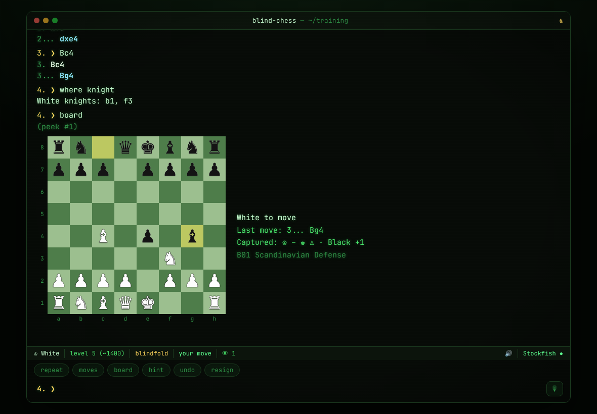
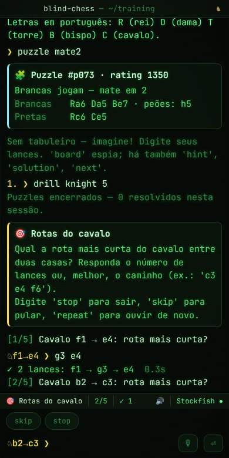

# ♞ Blind Chess Terminal

Treinador de **xadrez às cegas** em forma de terminal, direto no navegador. Jogue contra o Stockfish sem ver o tabuleiro — digitando ou falando os lances —, treine visualização com exercícios e puzzles e acompanhe sua evolução.

**[▶ Jogar agora](https://andersonfaller.github.io/blind-chess-terminal/)** · funciona offline · desktop e celular · português e inglês



*English summary [below](#english).*

---

## O que tem

| | |
|---|---|
| **Partidas às cegas** | Contra a engine em 10 níveis (≈400 até a força máxima) ou Elo exato (`elo 1800`). Três modos: `blind off` (vendo o tabuleiro, para aquecer), `blind on` (espiadas permitidas e contadas) e `blind strict` (nada de tabuleiro até o fim). |
| **Ajudas progressivas** | `board` (espiar), `pieces` (lista de peças), `where cavalo`, `what e5`, `legal`, `hint` (primeiro a peça, depois o lance), `eval`, `undo`. Cada ajuda conta na sua **nota às cegas** ao final da partida. |
| **Voz** | Os lances da engine são falados (`voice on/off`, escolha de voz e velocidade). Com `listen` você joga falando: *"cavalo f3"*, *"bispo toma e5"*, *"roque pequeno"*, *"tabuleiro"*, *"repetir"* (experimental; Chrome, Edge, Safari). No iPhone/iPad, toque no 🎙 a cada lance e mantenha o Ditado ativado nos ajustes; `listen info` mostra um diagnóstico. |
| **Exercícios** | `drill colors` (cor das casas), `drill diagonals`, `drill knight` (rotas do cavalo), `drill visualize` (siga uma sequência de lances e responda sobre a posição), `drill memory` (memorize uma posição em segundos). Tempo, sequência e recordes pessoais. |
| **Puzzles às cegas** | 180 mates em 1, 2 e 3 embutidos, com poucas peças e verificados pelo Stockfish — a posição é apresentada como lista de peças. Rating de puzzles próprio. `puzzle online` busca puzzles do Lichess. |
| **Análise pós-partida** | `review`: precisão (fórmula do Lichess), imprecisões/erros/capivaradas, o melhor lance em cada momento crítico e gráfico de avaliação. |
| **Aprender aberturas** | A abertura é identificada durante a partida (≈160 linhas, reconhece transposições), com nome em português. |
| **Progresso** | `stats`, 16 conquistas (`achievements`), dias de treino seguidos, guia de treino passo a passo (`guide`). |
| **Exportar** | `pgn`, `copy`, `download`, `lichess` (abre no tabuleiro de análise), `load <FEN ou PGN>` para treinar uma posição específica. |
| **Terminal de verdade** | Histórico (↑/↓), autocompletar (Tab), `Ctrl+L`, `Ctrl+C`, comandos clicáveis, botões rápidos contextuais, 7 temas (`theme`), efeito CRT, tamanho de fonte, relógio (`clock 5+3`). |
| **Robusto** | Partidas salvas automaticamente (feche a aba e use `resume`), funciona offline (PWA), acessível a leitores de tela (`boardstyle ascii`, região `aria-live`). |

### Notação

Aceita SAN (`e4`, `Nf3`, `exd5`, `O-O`, `e8=Q`), forma longa/UCI (`e2e4`, `g1-f3`), sem `x`, com maiúsculas trocadas pelo teclado do celular, figurinhas (`♘f3`) e — com `notation pt` — as letras em português: **R** (rei), **D** (dama), **T** (torre), **B** (bispo), **C** (cavalo): `Cf3`, `Dxd7`, `Tc1`.

## Engines — sem depender de uma API

A versão anterior dependia só da API stockfish.online. Agora a engine padrão roda **dentro do seu navegador**:

| `engine …` | O que é | Prós / contras |
|---|---|---|
| `auto` *(padrão)* | Stockfish local e, se falhar, as outras abaixo em sequência | Sempre há uma engine respondendo |
| `local` | **Stockfish 18 Lite** compilado para WebAssembly ([stockfish.js](https://github.com/nmrugg/stockfish.js)), num Web Worker | Offline, privado, sem limite de uso; níveis reais (`UCI_Elo`, *Skill Level*); ~7 MB baixados uma vez |
| `online` | API REST [stockfish.online](https://stockfish.online/) | Precisa de internet; só aceita profundidade |
| `chessapi` | API REST [chess-api.com](https://chess-api.com/) | Precisa de internet; só aceita profundidade |
| `basic` | Engine alfa-beta própria em JavaScript (`js/engine/basic-search.js`) | Fraca (nível clube), mas funciona em qualquer lugar |

Os níveis 1–3 escolhem de propósito entre as melhores linhas do Stockfish com margem de erro (joga "como humano", não aleatório); o 4 usa *Skill Level 0*; 5–9 usam o Elo calibrado do Stockfish; 10 é força máxima. `engine test` mostra qual engine respondeu e em quanto tempo.

Outras opções que avaliei e podem ser plugadas na mesma interface (`js/engine/manager.js`): o Stockfish multi-thread (mais forte, mas exige cabeçalhos COOP/COEP que o GitHub Pages não envia), o [Fairy-Stockfish](https://github.com/fairy-stockfish/fairy-stockfish.wasm) (variantes) e a *cloud eval* do Lichess (só avalia posições já analisadas, não serve como adversário).

## Como treinar

Digite `guide` no app. Em resumo:

1. `drill colors` até 20/20 em menos de 30 s;
2. `drill diagonals` e `drill knight`;
3. `drill visualize` e `drill memory`;
4. `puzzle mate1` → `mate2` → `mate3`;
5. partidas às cegas fracas (`play white 2`) espiando quando precisar — e cada vez menos;
6. `blind strict` com voz ligada, subindo o nível conforme a nota às cegas melhora.



## Rodar localmente

Não há build. Os módulos ES e o Worker do Stockfish precisam ser servidos por HTTP:

```bash
python3 -m http.server 8000      # ou: npm start
# abra http://localhost:8000
```

Testes (Node 18+, sem dependências):

```bash
npm test
```

Regerar o banco de puzzles (usa o Stockfish via Node):

```bash
node tools/gen-puzzles.mjs 70 70 40   # mate em 1, 2, 3
```

## Estrutura

```
index.html, css/style.css      interface do terminal e temas
js/app.js                      comandos, modos, voz, conquistas
js/terminal.js                 widget de terminal (histórico, Tab, status, botões)
js/game.js                     partida contra a engine, relógio, salvamento
js/drills.js                   exercícios de visualização
js/puzzles.js, js/review.js    puzzles e análise pós-partida
js/engine/                     Stockfish local, APIs REST, engine JS e fallback
js/chess-utils.js              parser de lances, notação PT/EN, fala
js/i18n.js                     textos em inglês e português
js/data/                       aberturas e puzzles
vendor/                        chess.js 1.4.0 e Stockfish 18 (WASM)
sw.js, manifest.webmanifest    PWA / offline
tests/, tools/                 testes e gerador de puzzles
```

## Créditos e licenças

- Código deste projeto: MIT ([LICENSE](LICENSE)).
- [Stockfish](https://stockfishchess.org/) e [stockfish.js](https://github.com/nmrugg/stockfish.js): GPLv3 — veja `vendor/stockfish/Copying.txt`. O binário é distribuído sem modificações, como programa separado executado num Web Worker.
- [chess.js](https://github.com/jhlywa/chess.js): BSD-2 — `vendor/chess.js/LICENSE`.
- Tabelas peça-casa da engine embutida: *Simplified Evaluation Function*, de Tomasz Michniewski.
- Ideia original: terminal para jogar com a API [stockfish.online](https://stockfish.online/).

---

## English

**Blind Chess Terminal** is a blindfold chess trainer with a terminal UI that runs entirely in the browser.

- **Blindfold games** against Stockfish at 10 levels (or an exact Elo), in three modes: sighted warm-up, blindfold with counted peeks, and strict.
- **Aids that are counted** into a blind score: `board`, `pieces`, `where knight`, `what e5`, `legal`, progressive `hint`, `eval`, `undo`.
- **Voice**: engine moves are spoken; `listen` lets you play by speaking ("knight f3", "castles kingside").
- **Drills**: square colors, diagonals, knight routes, follow-the-moves visualisation and position memory.
- **Puzzles**: 180 built-in Stockfish-verified mates in 1–3 presented as piece lists, plus Lichess puzzles online, with a puzzle rating.
- **Game review** with accuracy, mistakes and best moves; opening names; stats and achievements; PGN/FEN import and export; Lichess analysis link.
- **No single point of failure**: Stockfish 18 runs locally as WebAssembly by default, falling back to the stockfish.online and chess-api.com REST APIs and finally to a built-in JavaScript engine.
- Works offline (PWA), saves games automatically, English and Brazilian Portuguese UI (`lang en|pt`), Portuguese piece letters (`notation pt`), 7 themes, mobile friendly, screen-reader friendly.

Run it locally with `python3 -m http.server` and open `http://localhost:8000`; run the tests with `npm test`. Type `help` in the app for every command and `guide` for a training plan.
